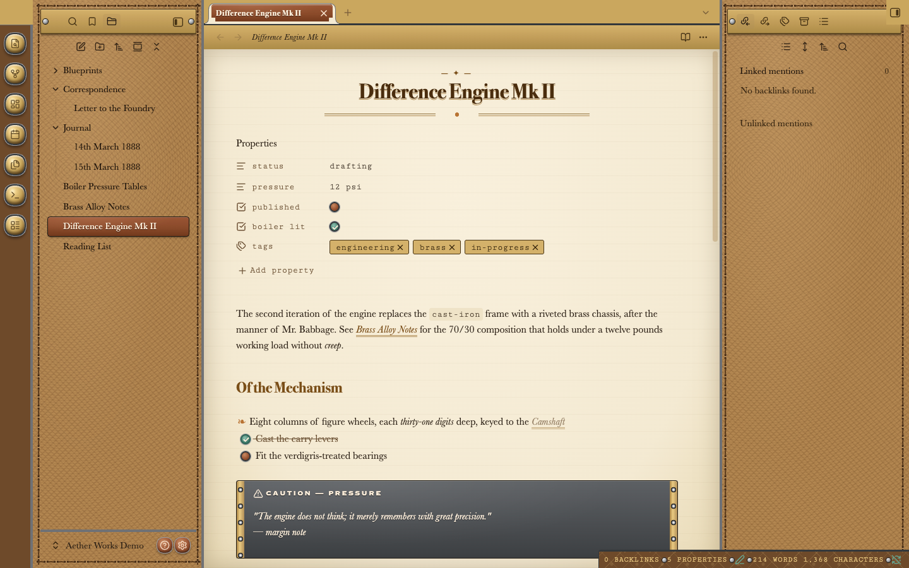
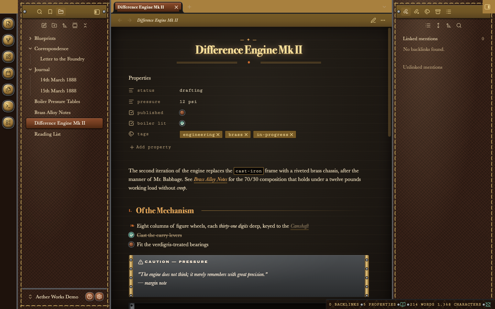
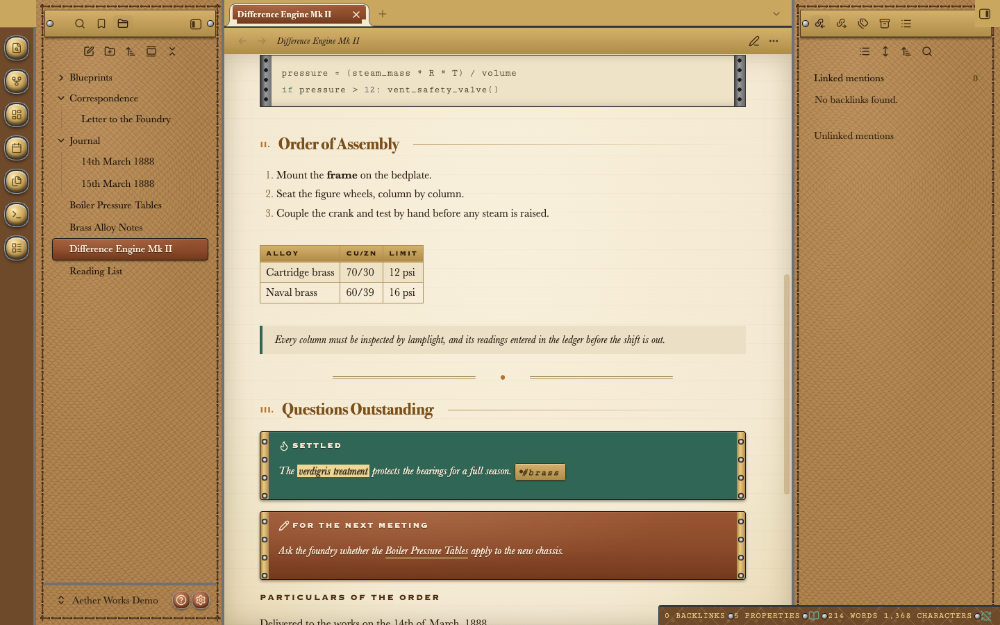
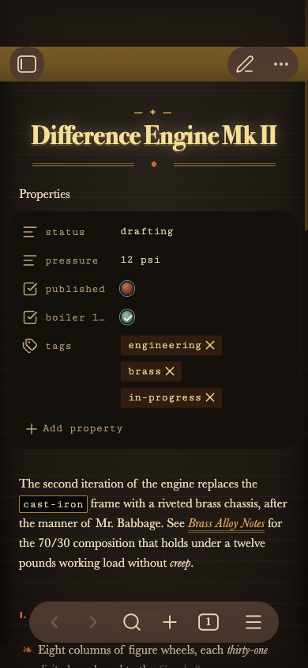
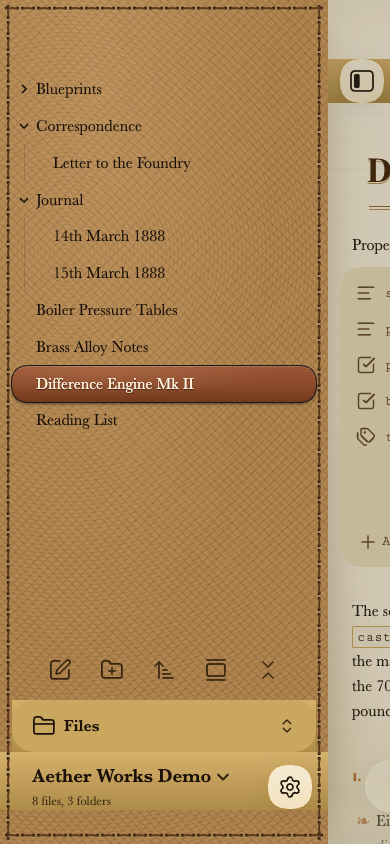
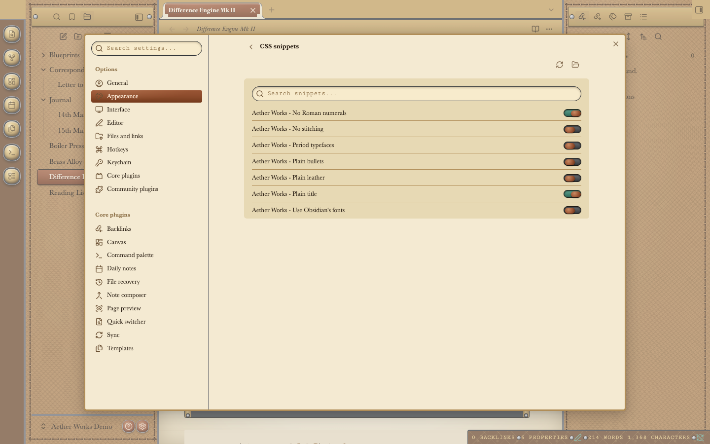
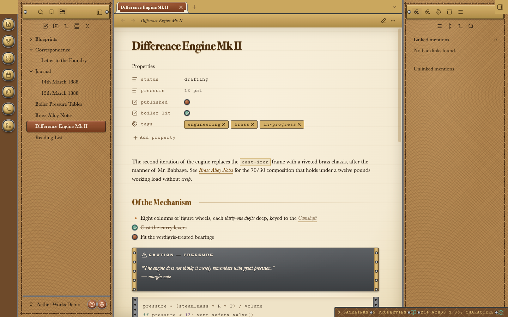

# Aether Works

A Victorian steampunk theme for Obsidian, in light and dark modes. Notes are written on ruled parchment under a brass plaque. The sidebars are stitched saddle leather, the ribbon buttons are domed brass, and the open note and open file are copper plates. Headings are set in period typefaces, with a typewriter face for code. It works on desktop, tablet and phone, needs no plugins, and loads nothing from the internet.

*Dark mode, editing a note. Down the far left is the ribbon: a column of domed brass push-buttons. Next to it, the file explorer sits on oxblood leather with a dashed running stitch around its edge, and the open file, "Difference Engine Mk II", is a raised copper plate. Brass nameplates held by two screws head both sidebars. In the middle, the note's title is centred and lit like a lamp, with a small "— ✦ —" kicker above it and a double brass rule with a copper dot below it. The properties are typed in a typewriter face, and their tags are brass tokens. Lower down, a caution callout is a blackened-iron plate with riveted brass strips at each end. In the bottom right, the status bar is a leather strap with small steel screws between its readings.*

## Light and dark

*Light mode, editing the same note. The leather turns to tan saddle leather and the page to cream parchment ruled with faint horizontal lines, like a ledger. The title is set in dark brown ink, and links are italic over a double brass underline (see "Brass Alloy Notes" in the first paragraph). The fleuron (❧) before the first list item replaces the usual bullet. Ticked tasks are a verdigris-green valve knob, open ones a copper knob.*

Obsidian's *Settings → Appearance → Base color scheme* switches between them. Both modes are tested for readable contrast.

*Dark mode, reading view. In reading view, second-level headings gain a small copper Roman numeral ("I.", "II.", …) and a fine brass rule running out to the right margin, like a section in a printed manual. Inline code ("cast-iron") is set in the typewriter face inside a thin brass outline.*

*Light mode, lower in the same note. A table becomes a ledger: brass heading strip, engraved small capitals, and fine ruled cells. A quotation is a margin note with a verdigris bar. A horizontal rule is the double brass flourish with a copper dot. Callouts are metal plates with riveted brass ends. Tips and successes are verdigris ("Settled"), ordinary notes are copper ("For the next meeting"), and warnings are blackened iron (shown above). At the top, a code block runs like telegraph tape between two sprocketed steel guides.*

## What it changes

- **The workspace.** Leather sidebars with a running stitch, domed brass ribbon buttons, copper help and settings buttons beside the vault name, brass nameplates on the sidebar tab bars, and a leather status bar.
- **The page.** Ruled parchment under a brass plaque header. Editor tabs are brass tags, and the open tab is copper.
- **Type.** A centred title with a kicker and flourish, Roman-numbered section headings in reading view, and fleuron bullets.
- **Details.** Valve-knob checkboxes, brass tag tokens, telegraph-tape code blocks, ledger tables, and riveted callout plates in copper, verdigris and iron.
- **Menus and dialogs.** Parchment in a brass border, with a matte brass bar marking the chosen row.

The [User Guide](USERGUIDE.md) walks through every part, with pictures.

## Typefaces

Out of the box, Aether Works uses period-style serifs most systems already have, and embeds one typeface of its own:

- **Headings:** Bodoni or Didot, the high-contrast serifs of 19th-century print (Palatino or Georgia where those aren't installed).
- **Text and interface:** Baskerville (Palatino or Georgia elsewhere).
- **Engraved plates, buttons and table headings:** Copperplate's engraved capitals.
- **Code, tags and properties:** **Cutive Mono**, embedded, a typewriter face drawn from the Smith Premier of 1889.

For the full period look on every system, switch on the optional **Period typefaces** snippet ([Options](#options-without-plugins)). It embeds the three typefaces the theme was designed with: **Playfair Display** for headings, **IM Fell English**, a revival of 17th-century English printing type, for text, and **Cinzel**, after Roman inscriptions, for plates. They're kept out of `theme.css` because together they're about 250 KB, and Obsidian's directory asks for themes to stay small.

All the embedded typefaces are under the SIL Open Font License. Its full text and the fonts' copyright notices are inside each file that embeds them, and in [fonts/](fonts/README.md). Any font you choose under *Settings → Appearance* takes priority, and the *Use Obsidian's fonts* option hands every font back to Obsidian.

## Phones, tablets and small windows

*A phone in dark mode. The page fills the screen, and the title keeps its kicker and flourish. The brass plaque header at the top carries the sidebar and edit buttons. The checkboxes are slightly larger, so they're easier to tap.*

*The file drawer on a phone, in light mode, opened by swiping in from the left edge. It's the same stitched saddle leather as the desktop sidebar, with the folder tree in dark ink and the open file as a copper plate. At the foot, the "Files" selector and the vault name sit on brass plates, beside a round settings button.*

As a window or a split pane narrows, the title shrinks, the heading rules drop away, the callout and code-block strips slim down, and the sidebars give way to the page.

## Options, without plugins

Six options switch parts of the theme off, and one adds the period typefaces. Each is a small CSS snippet that Obsidian switches on and off by itself, with no plugin needed. In-note options can also be set note by note:

| Option | What it does | Per note (off / keep on) |
| --- | --- | --- |
| Period typefaces | Embeds Playfair Display, IM Fell English and Cinzel (about 250 KB) | — |
| Use Obsidian's fonts | Your Obsidian fonts replace the theme's | — |
| Plain leather | Flat colour instead of leather grain and damask | — |
| No stitching | Removes the running stitch | — |
| No Roman numerals | Unnumbered headings and outline | `aw-no-numerals` / `aw-numerals` |
| Plain bullets | Ordinary bullets instead of fleurons | `aw-plain-bullets` / `aw-fleurons` |
| Plain title | A left-aligned title, without kicker or flourish | `aw-plain-title` / `aw-title-ornament` |

*The snippets in Obsidian's own settings (Settings → Appearance → CSS snippets). Each option has its own "Aether Works - …" switch. Here "No Roman numerals" and "Plain title" are on (verdigris) and the rest are off (copper). The [User Guide](USERGUIDE.md#options) explains how to install them.*

*The note with "Plain title", "No Roman numerals" and "Plain bullets" switched on. The title is left-aligned without its kicker and flourish, the section heading has no numeral, and the list has an ordinary bullet. Compare with the light-mode picture above.*

If you use the Style Settings plugin, the six options also appear there as switches. The theme never needs it.

## Accessibility

Every text colour is tested against WCAG 2 in both modes. Body text, links, sidebar text, plaque lettering and callout text reach at least 4.5:1, and faint helper text reaches 3:1. In Windows high-contrast mode the textures and metal give way to the system colours. Printing and PDF export use black ink on white.

## Compatibility

- **Obsidian 1.6 or later.**
- The options work on every version Obsidian 1.6 runs on: they are plain CSS variables.
- The narrow-pane adjustments use CSS container queries, which need:
  - **Desktop:** Obsidian installer 1.4 or later. The installer version is shown in *Settings → General*.
  - **iPhone and iPad:** iOS / iPadOS 16 or later.
  - **Android:** Android System WebView 105 or later.

  On older versions everything else works, including the options; pages just don't slim down in narrow panes.

## Installing

Aether Works isn't in Obsidian's community directory yet. To install it by hand:

1. Download `manifest.json` and `theme.css` from the latest release (they're also in this repository's root).
2. Put them in a folder named exactly `Aether Works` inside `<your vault>/.obsidian/themes/`.
3. Choose **Aether Works** under *Settings → Appearance → Themes*.

The [User Guide](USERGUIDE.md) covers installing the option snippets, updating, and troubleshooting.

## Development

See [AGENTS.md](AGENTS.md) for the build, the tests, the rules the linters enforce, and how to deploy to a vault.

## Licence

The theme is under the [MIT License](LICENSE), © 2026 Anthony Fitzpatrick. The embedded fonts keep their own licence, the SIL Open Font License ([fonts/](fonts/README.md)). The vendored anti-slop lint rules in `tools/oxlint/anti-slop/` are MIT, © Dillon Mulroy.
