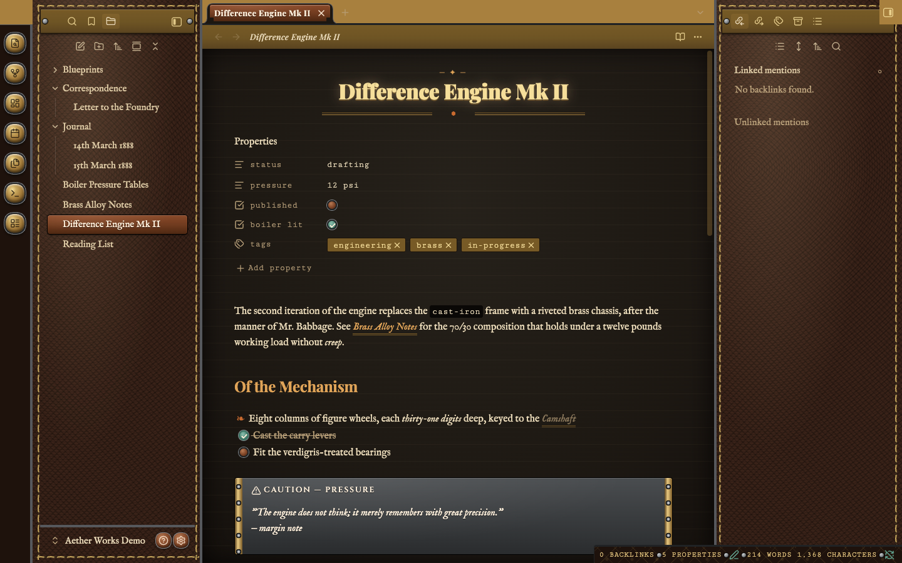
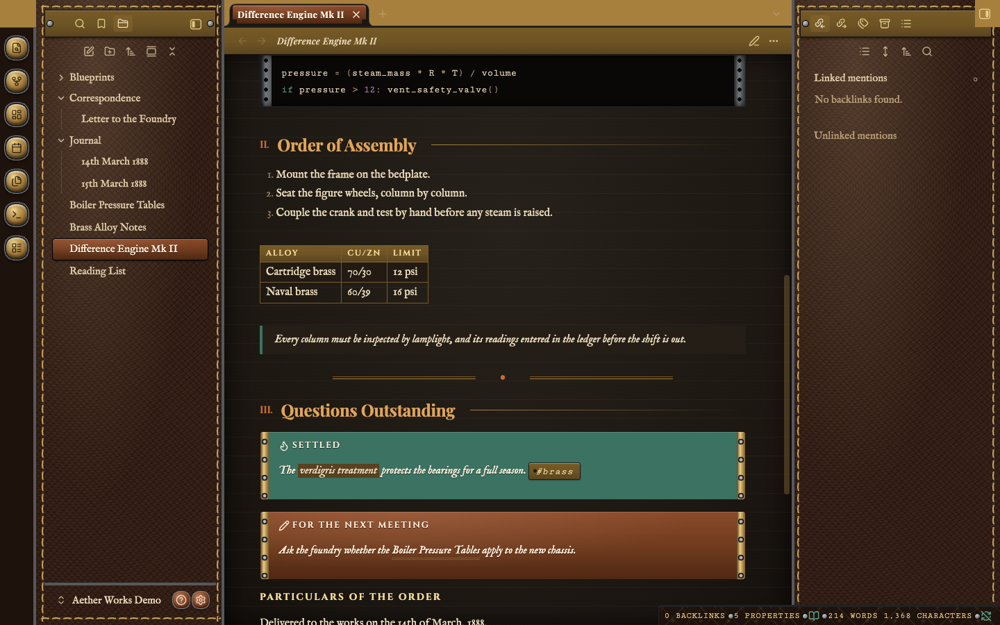
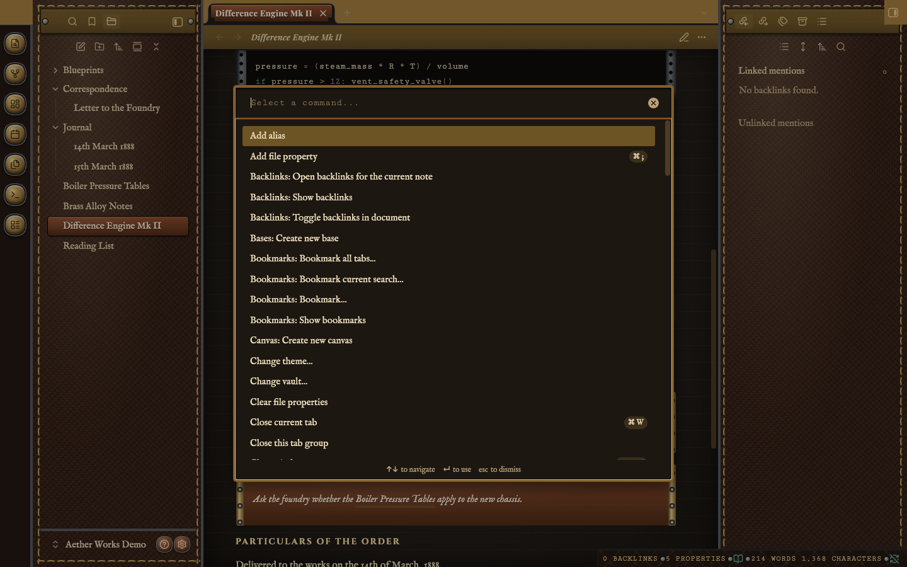

# Aether Works — User Guide

Aether Works dresses Obsidian as a Victorian instrument maker's workshop: parchment pages, saddle leather, brass fittings and copper plates. This guide covers installing it, what each part of the workspace looks like and does, the six options and how to switch them without any plugin, and what to do when something doesn't look right.

## Contents

1. [Installing and updating](#installing-and-updating)
2. [Light and dark](#light-and-dark)
3. [A tour of the workspace](#a-tour-of-the-workspace)
4. [Writing and reading](#writing-and-reading)
5. [Callouts](#callouts)
6. [Menus, the command palette and settings](#menus-the-command-palette-and-settings)
7. [Typefaces](#typefaces)
8. [Options](#options)
9. [Phones, tablets and small windows](#phones-tablets-and-small-windows)
10. [Accessibility and printing](#accessibility-and-printing)
11. [Compatibility](#compatibility)
12. [Troubleshooting](#troubleshooting)

## Installing and updating

Aether Works isn't in Obsidian's community directory yet, so it's installed by hand:

1. Download `manifest.json` and `theme.css` from the latest release (they're also in the root of the repository).
2. In your vault, open the hidden `.obsidian` folder and then `themes`. Create a folder named exactly **Aether Works**; Obsidian matches a theme by its folder name. Put both files in it.
3. In Obsidian, open *Settings → Appearance*, and under **Themes** choose **Aether Works**.

To update, replace both files with the new ones. Obsidian reads a theme once, when it's chosen, so switch to another theme and back (or restart Obsidian) to see the update.

To remove the theme, choose another theme and delete the `Aether Works` folder. If you installed the option snippets, delete the files starting "Aether Works - " from `.obsidian/snippets` too.

## Light and dark

Aether Works has two modes, chosen with Obsidian's own *Settings → Appearance → Base color scheme*. Choosing "Adapt to system" follows your computer's setting.

- **Light** is cream parchment and polished brass on tan saddle leather, with dark-brown ink.
- **Dark** is oxblood leather and aged brass, with parchment-coloured ink and a title that glows like a lamp.

Every colour pairing is tested for readable contrast in both modes (see [Accessibility](#accessibility-and-printing)).

Obsidian's **Accent colour** setting has no effect under Aether Works. The theme's copper takes the accent's place, because the copper is part of the design and its contrast is tested.

## A tour of the workspace



*The workspace in dark mode, from left to right:*

- *The **ribbon**, a column of domed brass push-buttons, each set in a steel collar. They brighten when you point at them and press in when clicked.*
- *The **left sidebar**, the file explorer here, on oxblood leather. A dashed running stitch is sewn around its edge. Its tab bar is a matte brass nameplate held by a screw at each end. The open file, "Difference Engine Mk II", is a raised copper plate. At the foot, beside the vault name, the help and settings buttons are small copper domes.*
- *The **editor**. The tab bar across the top holds the open note's tab as a copper plate (other tabs are brass). Under it, the note's header is a brass plaque carrying the back and forward arrows, the note's name in italics and its view buttons. The page below is ruled parchment, dark here.*
- *The **right sidebar**, here the Backlinks pane, on the same stitched leather under its own nameplate.*
- *The **status bar** in the bottom-right corner is a leather strap with small steel screws between its readings, set in typewriter capitals.*

Between the panes, steel rails divide the workspace. Drag them to resize as usual.

## Writing and reading


*A note in reading view, light mode. From the top:*

- *The **title** is centred in Playfair Display, with a small "— ✦ —" kicker above it and a double brass rule with a copper dot beneath it.*
- *The **properties** are typed in the typewriter face, and the tags in them are brass tokens.*
- *In the **paragraph**, "cast-iron" is inline code in a thin brass outline, and "Brass Alloy Notes" is a link: italic, over a double brass underline.*
- *The **section heading** "I. Of the Mechanism" has a copper Roman numeral before it and a fine brass rule after it.*
- *In the **list**, the first item has a fleuron (❧) instead of a bullet. The two tasks have valve knobs: verdigris and ticked for "Cast the carry levers", copper and open for "Fit the verdigris-treated bearings".*

Element by element:

| Element | How it looks | Where |
| --- | --- | --- |
| Note title | Centred, with a kicker above and a brass flourish below | Editing and reading |
| First-level heading in the note | Centred, with the brass flourish below | Reading; centred while editing |
| Second-level heading | Copper Roman numeral before it, brass rule after it | Numeral and rule in reading view only |
| Fourth- to sixth-level headings | Spaced engraved capitals | Editing and reading |
| Bulleted list | Fleurons (❧) in copper | Editing and reading |
| Task | Copper valve knob; turns verdigris with a tick when done, and the text is struck through | Editing and reading |
| Link | Italic, over a double brass underline that turns copper on hover | Editing and reading |
| Tag (`#brass`) | Brass token with a punched hole, in the typewriter face | Editing and reading |
| Inline code | Typewriter face in a thin brass outline | Editing and reading |
| Code block | Telegraph tape between two sprocketed steel guides | Reading view |
| Highlight (`==text==`) | Brass ink behind the text | Editing and reading |
| Quotation | Italic margin note with a verdigris bar | Editing and reading |
| Horizontal rule | The double brass flourish with a copper dot | Reading view |
| Table | A ledger: brass heading strip with engraved small capitals | Editing and reading |
| Properties | Names and values typed in the typewriter face | Editing and reading |

The Roman numerals on second-level headings count the sections of each note, so they appear in reading view, where the whole note is laid out. While you edit, headings stay plain so the numbers don't jump about as you type. The Outline pane numbers its entries the same way, like a table of contents.

## Callouts



*Callouts in dark mode, with other elements around them:*

- *At the top, a code block runs as telegraph tape between steel guides, and a numbered list follows.*
- *The ledger table has a brass heading strip.*
- *The quotation is a margin note with a verdigris bar, and the rule below it is the brass flourish.*
- *The two callouts are metal plates with riveted brass strips at both ends: verdigris for the "Settled" tip, copper for the "For the next meeting" note. The titles are engraved capitals, and the text inside is italic in the plate's cream lettering.*

Every callout is a riveted plate, and its metal tells you its kind:

| Plate | Callout types |
| --- | --- |
| **Copper** | `note`, `abstract`, `summary`, `info`, `todo`, `question`, `example`, `quote` and any custom type |
| **Verdigris** (green) | `tip`, `hint`, `important`, `success`, `check`, `done` |
| **Blackened iron** (grey) | `warning`, `caution`, `attention`, `danger`, `error`, `bug`, `failure`, `fail`, `missing` |

Links and code inside a callout are re-inked in the plate's cream lettering to stay readable on the metal, and folding callouts (`> [!note]-`) work as usual.

## Menus, the command palette and settings



*The command palette in dark mode. It sits in a brass border over the page. The search field at the top is typed in the typewriter face. The chosen command, "Add alias", is marked with a matte brass bar, and keyboard shortcuts appear as small tokens on the right. Right-click menus, the quick switcher and other pickers look the same.*


*Settings in light mode. The settings window is parchment in a brass border. In the list on the left, the chosen section, "Appearance", is a copper plate. Ordinary buttons such as "Manage" and "Check for updates" are matte brass plates with engraved capitals. The main action in a dialog (for example "Create" or "Save") is copper. Buttons for destructive actions (for example "Delete") are sealing-wax red. Switches are a copper knob in a steel slot that fills with verdigris when on. The font-size slider has a brass knob.*

Notices and tooltips are brass lettering on dark leather, and hover previews of links are small brass-bordered sheets.

## Typefaces

Aether Works carries its own typefaces inside `theme.css`, so it looks the same with or without an internet connection:

| Typeface | Era and style | Used for |
| --- | --- | --- |
| **IM Fell English** | A revival of 17th-century English printing type | Body text and the interface |
| **Playfair Display** | A high-contrast serif in the late-18th-century style | Titles, headings, editor tabs |
| **Cinzel** | Capitals after Roman inscriptions | Engraved plates, buttons, callout titles, table headings |
| **Cutive Mono** | A typewriter face drawn from the Smith Premier typewriter of 1889 | Code, tags, properties, the status bar |
| **Rye** | A poster face of the Victorian frontier | The window title bar on Windows and Linux |

Only the Latin character set is embedded. Text in other scripts falls back to your system's fonts.

**Using your own fonts.** Fonts you choose under *Settings → Appearance* (interface font, text font and monospace font) take priority over the theme's. To turn all five embedded typefaces off at once, switch on the *Use Obsidian's fonts* option (see [Options](#options)).

## Options

Aether Works has six options. Each switches part of the theme off, and all of them work with Obsidian alone. No plugin is needed.

| Option | What it does | Can be set per note |
| --- | --- | --- |
| Use Obsidian's fonts | Replaces the five embedded typefaces with your Obsidian font choices | No |
| Plain leather | Flat colour instead of leather grain and damask | No |
| No stitching | Removes the running stitch around the sidebars and drawers | No |
| No Roman numerals | Removes the numerals from section headings and the Outline | Yes |
| Plain bullets | Ordinary bullets instead of fleurons | Yes |
| Plain title | A left-aligned title, without the kicker and flourish | Yes |

### For the whole vault: CSS snippets

Each option is a small CSS snippet, a feature built into Obsidian:

1. Get the snippet files: `aether-works-snippets.zip` on the latest release, or the repository's `snippets` folder.
2. In your vault, open the hidden `.obsidian` folder and then `snippets` (create it if it isn't there), and copy in the files you want. You can copy all six; nothing changes until a snippet is switched on.
3. In Obsidian, open *Settings → Appearance*, scroll to **CSS snippets** and open it. If the snippets don't appear yet, select the refresh button.
4. Switch on the options you want.


*The CSS snippets page, in light mode. Each option has its own "Aether Works - …" switch. In the theme, a switch that is on shows a verdigris track and one that is off shows a copper knob in a steel slot. Here "No Roman numerals" and "Plain title" are on. The refresh and folder buttons above the list reload the snippets and open the snippets folder.*

### For one note: cssclasses

The three options that change a note's own text (numerals, bullets and the title) can also be set for a single note, through the note's `cssclasses` property. This works whether or not you use the snippets. Add the property in the note's properties, or at the top of the note:

```yaml
---
cssclasses:
  - aw-plain-title
  - aw-plain-bullets
---
```

| Ornament | Turn it off in this note | Keep it in this note while its snippet is on |
| --- | --- | --- |
| Roman numerals | `aw-no-numerals` | `aw-numerals` |
| Fleurons | `aw-plain-bullets` | `aw-fleurons` |
| Title ornament | `aw-plain-title` | `aw-title-ornament` |


*The note from the earlier pictures, with "Plain title", "No Roman numerals" and "Plain bullets" switched on. The title "Difference Engine Mk II" is now left-aligned in the same heading face, with no kicker above or flourish below. "Of the Mechanism" has no numeral before it. The first list item has a plain copper dot instead of a fleuron. Everything else, from the parchment and properties to the valve knobs and the iron caution plate, is unchanged.*

### Style Settings (optional)

If you already use the Style Settings community plugin, the same six options also appear there, under *Aether Works*. It's only a convenience: the theme never needs it, and the snippets and `cssclasses` do the same job.

## Phones, tablets and small windows


*A phone in dark mode. The page fills the screen with no margin around it. The brass plaque header across the top carries the button for the left drawer and the edit and menu buttons. The title wraps cleanly over two lines. The properties keep their typewriter face, and the checkboxes are a little larger so they're easier to tap. Obsidian's floating navigation bar sits at the bottom.*


*The left drawer on a phone, in light mode. Swipe in from the left edge, or tap the sidebar button. The drawer is the same stitched saddle leather as the desktop sidebar. The open note is a copper plate. At the foot, the "Files" selector and the vault name sit on brass plates.*

Tablets get the same leather drawers, toolbars and larger checkboxes.

Aether Works also adapts to the size of its window and of each pane:

- **Narrow windows** (below about 1,100 pixels): the stitching sits a little closer to the edge, and each sidebar is limited to 28% of the window so the page keeps its room. Below about 760 pixels the limit rises to 40%, so a sidebar stays wide enough to use.
- **Narrow panes**, for example one side of a split view: below about 640 pixels, the title shrinks, the rules after headings are dropped, and the callout strips and code-block guides become narrower. Below about 420 pixels, wide tables scroll sideways instead of squeezing.

## Accessibility and printing

- **Contrast.** Every text colour is tested against the WCAG 2 contrast standard in both modes. Body text, links, sidebar text, plaque lettering, button text and callout text reach at least 4.5:1, and faint helper text such as placeholders reaches 3:1.
- **High-contrast mode.** On Windows, with a high-contrast theme switched on (forced colours), the leather, damask and metal give way to the system's own colours.
- **Printing and PDF export.** Notes print as black ink on white, without metal plates or coloured backgrounds.
- **Reduced decoration.** The *Plain leather*, *No stitching* and *Use Obsidian's fonts* options give a calmer, flatter look. *Use Obsidian's fonts* also lets you choose a font you find easier to read.

## Compatibility

- **Obsidian 1.6 or later.**
- The options and the narrow-pane adjustments rely on modern CSS (container and style queries). They need:
  - **Desktop:** Obsidian installer 1.4 or later, which uses Electron 25. *Settings → General* shows your installer version. If it's older, download the current installer from obsidian.md.
  - **iPhone and iPad:** iOS or iPadOS 18 or later.
  - **Android:** Android System WebView 111 or later. It updates through the Play Store.

  On older versions everything else still works, but every ornament stays on and the options have no effect.

## Troubleshooting

- **The theme isn't in the list.** The folder must be named exactly `Aether Works` and must hold both `manifest.json` and `theme.css`.
- **An update or a snippet change doesn't show.** Obsidian reads a theme once. Switch to another theme and back, or restart Obsidian. For snippets, select the refresh button on the CSS snippets page.
- **An option has no effect.** Check that the snippet is switched on, and that the note doesn't override it in its `cssclasses`. On older devices, see [Compatibility](#compatibility).
- **My accent colour is ignored.** That's expected: the theme uses its own copper accent (see [Light and dark](#light-and-dark)).
- **Text in another script looks different.** Only Latin characters are embedded. Other scripts use your system fonts.
- **A plugin's panel looks wrong.** Check first whether one of your own CSS snippets styles the same element. If not, open an issue on the repository with a screenshot, your Obsidian version, and whether you were in light or dark mode.
